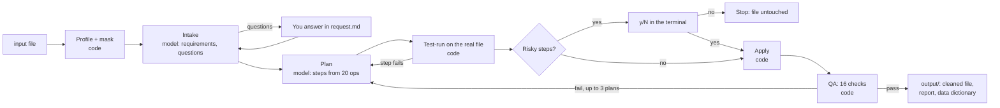

# ai-data-cleaning-agent

An LLM agent that cleans messy CSV, Excel and JSON files **without ever seeing the data**. The model plans; plain Python code makes every change, counts it, and checks the result.

**Benchmark:** fixed **536 of 545** injected errors (98%) across 5 datasets, broke **0 of 8,510** clean cells, lost **0** rows, at **$0.05 per file**. [Details](#benchmark)

```bash
python -m cleaner_agent run jobs/demo
```

## Why it's built this way

Most "AI cleans your spreadsheet" tools send the file to a model and trust what comes back. That leaks the data, and a model that rewrites cells can quietly change values. This agent splits the work:

| The model does | Code does |
|---|---|
| Reads column statistics and value *shapes* | Reads the real file |
| Turns the request into checkable requirements | Checks row and column limits |
| Picks steps from a fixed list of 20 operations | Rejects any other step, then runs and counts each one |
| Writes the report summary from counts | Runs 16 QA checks on the result |

No model-written code ever runs. A value that can't be converted is left as it was and counted, never silently blanked.

## How it works



1. **Profile and mask** (`common.py`). Every cell is read as text so nothing changes on the way in. Each column gets statistics: missing values, distinct values, untrimmed cells, and value *patterns*, where letters become `a`/`A` and digits `9`, so `(555) 123-4567` becomes `(999) 999-9999`. [RapidFuzz](https://github.com/rapidfuzz/RapidFuzz) groups values that are probably the same thing written differently ("New York", "new york").
2. **Intake** (`intake/`, a small model). Turns "fix the dates" into "every value in signup_date is YYYY-MM-DD" and asks only what would cause a wrong result. In the demo it stopped to ask whether `03/04/2024` is March 4 or April 3 rather than guess.
3. **Plan** (`cleaner/`, a stronger model). Picks steps from [`ops.py`](cleaner_agent/cleaner/ops.py), the only operations that exist: trim, standardize dates, phones ([libphonenumber](https://github.com/daviddrysdale/python-phonenumbers)), emails, numbers, case, value mapping, dedupe, split, merge and so on. The plan is test-run on the real file; if a step fails, the error (with no data values) goes back for a fix.
4. **Approve.** Steps that delete or change the meaning of data (dropping rows or columns, filling blanks, remapping values, removing more than 5% of rows) wait for `Run this plan? [y/N]`. The yes is tied to that exact plan, so any change needs a new one. With no terminal attached, the answer is no.
5. **Apply and QA** (`qa/`). The original file is never written to. QA checks that row counts add up, nothing was blanked unexpectedly, required columns exist, no duplicates or stray spaces are left, and more. A failure goes back to the planner, up to 3 plans; a failed job gets no output.

## Privacy design

What reaches the model is set per job with `ai_data_sharing` in `request.md`:

| Mode | The model sees |
|---|---|
| `all_masked` (default) | Statistics and value patterns only, for every column |
| `pii_masked` | Real sample values, except columns that look personal (by header, like name, email, phone, address, city; or by content, if over 20% of values look like emails or phones) |
| `none` | Nothing; the job stops |

The trade-off is real: in the demo the `city` column is masked, so the model saw `Aa` instead of "huston" and couldn't fix the typo. It said so in the report instead of guessing. `tests/test_pipeline.py` sends the demo file through the whole pipeline and checks that no name, email or phone number from it appears in anything sent to the model.

## Cost controls

Every model call is logged to `costs.csv` (step, tokens, dollars). Each step has its own monthly cap (`budget.monthly_cap_usd` in its `config.yaml`) and stops before calling the model once its own spend this month reaches it. The judgment-heavy planning step uses the stronger model; intake and the report use a cheaper one:

| Step | Model | Typical cost per file |
|---|---|---|
| Intake | claude-haiku-5-5 | $0.002 |
| Plan | claude-sonnet-5-5 | $0.046 |
| QA report | claude-haiku-5-5 | $0.0006 |

A rerun only redoes steps whose inputs changed, so a finished job reruns for $0.

## Benchmark

[`benchmark/`](benchmark/) generates 5 synthetic datasets of 300 rows (customers, orders, employees, event registrations, inventory) from a fixed seed, injects 545 known errors, runs the agent unattended (`--yes`), and scores every cell against the clean truth:

- **fixed**: the injected error's cell now matches the clean value exactly (numbers by value)
- **broke**: a cell that was already correct no longer matches, or a real row went missing

The scorer is tested both ways: the clean truth scores 100% and the untouched dirty file 0%, with nothing broken.

| Error type | Fixed |
|---|---|
| Stray spaces | 110/110 |
| Mixed date formats | 107/107 |
| Amounts like `$1,234.50` | 84/84 |
| Phone layouts | 40/40 |
| Email case | 41/41 |
| Duplicate rows (some differing only by spaces) | 40/40 |
| Empty rows | 15/15 |
| Missing markers (N/A, null, -) | 15/16 |
| Misspelled or miscapitalized categories | 84/92 |
| **Total** | **536/545 (98%)**, 0 of 8,510 clean cells broken |

**What it missed:** 8 category typos, all in two columns (`supplier` in inventory, `status` in orders) where the planner didn't plan a fix, and one "NA" marker it left out of its token list. Every file passed QA on the first plan. Full results: [`benchmark/results.md`](benchmark/results.md). The data is synthetic so the right answer for every cell is known; real files are messier.

## Run it

Requires Python 3.11+ and an [Anthropic API key](https://console.anthropic.com/).

```bash
python -m venv .venv
.venv\Scripts\activate            # Windows; on macOS/Linux: source .venv/bin/activate
pip install -r requirements.txt
echo ANTHROPIC_API_KEY=your-key > .env
python -m cleaner_agent run jobs/demo
```

To clean your own file, copy `jobs/demo/` to `jobs/<name>/`, put one file in `input/`, write what you want in `request.md`, and run `python -m cleaner_agent run jobs/<name>`. Results land in `jobs/<name>/output/`: the cleaned file, `cleaning-report.md`, and `data-dictionary.csv`. The plan with every step's expected effect is in `work/plan-review.md`.

```bash
python -m unittest discover -s tests -t .   # 35 tests, offline, no API key
python -m benchmark.generate                 # rebuild the benchmark data
python -m benchmark.run                      # about $0.26
```

## Layout

```
cleaner_agent/
  common.py        profiling, masking, file I/O, job folders
  llm.py, costs.py model call with budget check and cost log
  approval.py      y/N prompt, tied to the exact plan
  intake/          requirements and blocking questions
  cleaner/         ops.py (the 20 operations) and the planner
  qa/              checks and the output package
  __main__.py      the run command
benchmark/         generator, scorer, runner, results
jobs/demo/         a small made-up file to try it on
tests/             35 offline tests (the model is faked)
```

## Background

This started as the cleaning pipeline behind a freelance data-cleaning service, built with Claude Code. This repo is that pipeline extracted on its own, with the benchmark added to measure it.

## License

MIT, see [LICENSE](LICENSE).
